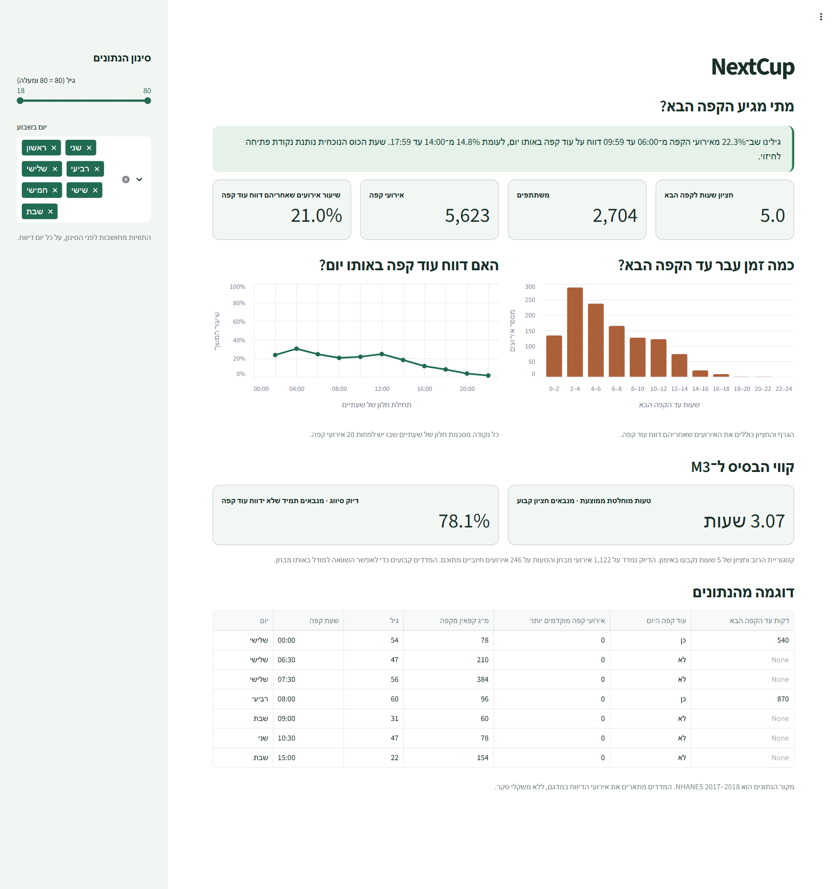

# ☕ NextCup

**יודעים מתי תרצו את הקפה הבא, ואיך תרגישו אחריו.**

רושמים כוס קפה, ו־NextCup עונה על שתי שאלות: האם צפויה עוד כוס היום, ואם כן, בעוד כמה זמן. כך אפשר לתכנן את הקפה הבא במקום לשתות מתוך הרגל.

📁 **הריפו של הצוות:** [github.com/Ariel-Vibe-Algorithm/NextCup](https://github.com/Ariel-Vibe-Algorithm/NextCup) · 🔗 **האפליקציה הראשונה (M1):** [NextCup בדפדפן](https://claude.ai/artifact/VYtcfAC9qJo8xFCdsj6svG?sk=XIbohddQbr__oy00HdKXfg)

---

## משפט הפרויקט

> **סטודנטים ועובדים ששותים קפה** סובלים מ**שתייה לא מתוכננת, נפילות אנרגיה ושינה שנפגעת מקפה מאוחר מדי**, ואנחנו בונים **אפליקציה שחוזה מתי תגיע כוס הקפה הבאה** שמשתמשת ב**מודל ML שאומן על זמני שתיית הקפה של כ־2,700 אנשים (סקר NHANES)**.

## הבעיה

רוב שותי הקפה לא מחליטים מתי לשתות. הם מגיבים לעייפות או להרגל. התוצאה: קפה בשעה לא נכונה, נפילת אנרגיה באמצע היום, וקפה של 17:00 שעדיין בגוף בחצות (זמן מחצית החיים של קפאין הוא כ־5 שעות).
התמקדנו בקפה כי הוא מקור הקפאין העיקרי: בנתוני M1 קפה היה כמחצית מהמשקאות עם קפאין, אבל כ־70% מכל הקפאין. כוס טיפוסית מכילה כ־108 מ״ג, לעומת כ־48 בתה וכ־36 בקולה.

## פרסונה ותרחיש

**נועה, 23, סטודנטית שנה ג׳ להנדסה.** שותה 3–4 כוסות קפה ביום, בעיקר בספרייה. בתקופת מבחנים היא נרדמת ב־2 בלילה ומתעוררת עייפה, וכך המעגל ממשיך.

**התרחיש:** 13:30, נועה שותה אספרסו אחרי ארוחת צהריים ורושמת אותו ב־NextCup. האפליקציה מציגה לה: *״לפי אנשים עם דפוס דומה, הקפה הבא שלך צפוי בסביבות 18:30. אם תשתי אותו, יישארו בגוף כ־40 מ״ג קפאין כשתלכי לישון ב־00:30.״* נועה מחליטה להקדים לקפה קטן ב־16:00, או לוותר עליו ולצאת להליכה.

## הרצה מקומית

מתיקיית הפרויקט, עם Python 3.11 או 3.12:

```powershell
python -m venv .venv
.\.venv\Scripts\python.exe -m pip install -r requirements.txt
.\.venv\Scripts\python.exe -m streamlit run app.py
```

הנתונים המעובדים כבר נמצאים בתיקייה `data/`. לשחזור מטבלאות המקור מריצים `python data/build_next_coffee.py`. הסקריפט משתמש בקבצים שכבר נמצאים ב־`data/raw/`, ומוריד קבצים חסרים מ־CDC ומ־USDA.

למחברת החקירה (`notebooks/eda.ipynb`) מתקינים גם את `requirements-notebook.txt` ובוחרים את אותה סביבת Python.

## Data Card

| שדה | פירוט |
|---|---|
| מקור ותקופה | סקר NHANES/WWEIA של CDC ו־USDA בארה״ב, 2017–2018. השתמשנו בשני קובצי דיווח תזונתי של 24 שעות, בקובץ הדמוגרפיה ובמיפוי המזונות הרשמי לקטגוריות. [יום 1](https://wwwn.cdc.gov/Nchs/Data/Nhanes/Public/2017/DataFiles/DR1IFF_J.htm) · [יום 2](https://wwwn.cdc.gov/Nchs/Data/Nhanes/Public/2017/DataFiles/DR2IFF_J.htm) · [דמוגרפיה](https://wwwn.cdc.gov/Nchs/Data/Nhanes/Public/2017/DataFiles/DEMO_J.htm) · [מיפוי USDA](https://www.ars.usda.gov/northeast-area/beltsville-md-bhnrc/beltsville-human-nutrition-research-center/food-surveys-research-group/docs/dmr-food-categories/) |
| גודל ויחידת תצפית | CSV עם 5,623 שורות ו־18 עמודות, 2,704 משתתפים ו־4,443 ימי דיווח שבהם תועד קפה. שורה מייצגת דקת דיווח אחת שבה נמצא לפחות פריט קפה מקטגוריה 7302 עם 10 מ״ג קפאין ומעלה. [מילון הנתונים](data/README.md) |
| משתנה יעד | `has_next_coffee` הוא יעד סיווג בינארי. הערך 1 מציין אירוע קפה נוסף בהמשך אותו יום דיווח. במקרים האלה `minutes_to_next_coffee` שומר את פער הזמן בדקות, כיעד רגרסיה משני. בסוף היום עמודת הפער ריקה. |
| חוסרים ובעיות | 3,513 פריטי מקור מ־294 ימי דיווח לא מהימנים הוצאו. בבדיקה נפרדת נמצאו 1,747 חוסרי קפאין בקלט הגולמי. בקרב המשקאות שנבחרו אחרי סינון המהימנות והגיל לא נמצאו ערכי זמן או קפאין בלתי תקינים. בדקנו כפילות לפי מזהה שורת המקור. בקובץ הסופי חסרים רק פערים שאין דרך להגדיר בתחילת היום או בסופו. |
| גישה והטיות | נתוני שימוש ציבוריים לצרכים סטטיסטיים בכפוף לתנאי NCHS. יש לתת קרדיט למקור ולהימנע מזיהוי משתתפים. המדגם כולל בגירים שדיווחו על קפה בארה״ב, והגרפים מציגים שיעורים לא משוקללים לפי אירוע. עד שני ימי דיווח לא רצופים לאדם, דיווח בדיעבד ועיגול שעות מגבילים הכללה לסטודנטים בישראל ולחיזוי אישי. [תנאי שימוש NCHS](https://www.cdc.gov/nchs/policy/data-user-agreement.html) |

### מה תיקנו ולמה

- סיננו גיל 18 ומעלה ודיווח תזונתי מהימן לפי `DR1DRSTZ` ו־`DR2DRSTZ`. תווית 0 דורשת יום דיווח שאפשר לסמוך עליו. 60,935 פריטי מקור של קטינים יצאו לאחר סינון המהימנות. חיברנו את קובצי יום 1 ויום 2, הוספנו גיל ומין לפי `SEQN` וסיווג משקה לפי `food_code`. בכל חיבור בדקנו שלכל מפתח בטבלת הייחוס יש רשומה אחת. כל קודי המזון של הבגירים התאימו למיפוי, והחיבורים שמרו על מספר שורות הדיווח.
- החלפנו חיפוש מילות מפתח במיפוי USDA. קפה נקבע לפי 7302, ותה, משקאות קלים ומשקאות ספורט או אנרגיה משמשים רק לחישוב היסטוריית הקפאין. הסף 10 מ״ג הוא הגדרת העבודה למשקה עם קפאין. בדקנו גם 1 ו־20 מ״ג: התקבלו 6,142 ו־5,597 אירועי קפה בהתאמה, ושיעור הכוס הבאה עמד על 21.6% ו־20.9%, לעומת 21.0% בסף הראשי.
- בדקנו כפילות לפי משתתף, יום דיווח ומספר פריט מקורי, ולא נמצאו כפילויות כאלה. איחדנו 215 קבוצות משקאות שתועדו באותה דקה, מהן 150 קבוצות שכללו קפה. כך פערי הזמן תמיד חיוביים, והקפאין מכל השורות באותה דקה נשמר.
- שמרנו את הכמות המדווחת וסימנו 26 אירועי קפה שבהם סך הקפאין בדקה הוא לפחות 1,000 מ״ג. המקסימום הוא 5,040 מ״ג, וסכום כזה עשוי לשקף כמה מנות או דיווח חריג. באימון נבדוק רגישות לערכים האלה. 91.8% מאירועי הקפה דווחו על שעה עגולה או על חצי שעה.
- ייצגנו שעה בדקות מתחילת היום ואת פערי הזמן בדקות שלמות. אירוע ראשון ביום מקבל פער קודם חסר, ואירוע אחרון מקבל פער עתידי חסר. 4,443 שורות חסרות בכל אחת מעמודות הפער מסיבות אלה.

## מה גילינו

- ב־22.3% מאירועי הקפה בין 06:00 ל־09:59 דווח על עוד קפה באותו יום (725 מתוך 3,249), לעומת 14.8% בין 14:00 ל־17:59 (70 מתוך 472). חלק מהפער צפוי, כי אחרי כוס בבוקר נשארות יותר שעות עד חצות.
- רק 1,180 מתוך 5,623 אירועים כללו קפה נוסף באותו יום. כשדווח עוד קפה, חציון ההמתנה היה 5 שעות. שני המדדים עונים על שאלות שונות באפליקציה, ולכן הדשבורד מציג גם את שיעור ההמשך וגם את פיזור זמני ההמתנה.
- המתאם של שעת הכוס עם היעד הבינארי הוא ‎−0.13. שני מדדי הספירה מתחילת היום מתואמים ב־0.91, ומנת הקפאין מהקפה וסך הקפאין עד אותה דקה מתואמים ב־0.83. אלה זוגות לבדיקה באימון, כי שני שדות דומים לא בהכרח מוסיפים יכולת חיזוי.

## מה המודל יחזה (M3)

לכל כוס קפה שהמשתמש רושם:

- **סיווג:** האם תהיה עוד כוס קפה היום (`has_next_coffee`).
- **רגרסיה:** אם כן, בעוד כמה דקות (`minutes_to_next_coffee`).

הקלט הוא רק מה שידוע ברגע הכוס, לפי `analysis.FEATURES`: שעה, יום בשבוע, כמות הקפאין בכוס, וכמה קפה וקפאין כבר נשתו היום. אם האפליקציה תרשום רק קפה, המודל יאומן רק על שדות שאפשר לחשב מיומן קפה. החלוקה לאימון ומבחן היא **לפי אדם**, כך שאותו אדם לא מופיע בשני הצדדים.

## קווי בסיס ל־M3

חילקנו 2,175 משתתפים לאימון ו־529 למבחן, לפי מזהה משתתף, כך שכל ימי הדיווח של אותו משתתף נמצאים באותה קבוצה. הערכים שהחזאי הקבוע מחזיר נקבעו בנתוני האימון, והציונים חושבו במבחן.

| משימה | החזאי הקבוע | תוצאה במבחן |
|---|---|---|
| האם דווח עוד קפה | תמיד 0, קטגוריית הרוב באימון | 78.07% דיוק על 1,122 אירועים. Recall לקבוצה החיובית הוא 0. |
| כמה זמן עד הקפה הבא | תמיד 300 דקות, חציון היעד באימון | MAE של 184.48 דקות (3.07 שעות), על 246 אירועים שבהם דווח עוד קפה. |

ב־M3 נבדוק גם precision, recall ו־PR-AUC ליעד הסיווג, כי דיוק לבדו יכול להסתיר מודל שמפספס כמעט כל כוס נוספת. ההשוואה בין המודלים תיעשה על חלוקות פנימיות לפי אדם מתוך האימון, והמבחן נשאר קבוע להערכה הסופית.

## דשבורד



תוכנית החקירה נמצאת ב־[eda_plan.md](eda_plan.md), והמחברת שמבצעת אותה ב־[notebooks/eda.ipynb](notebooks/eda.ipynb).

## סיפורי משתמש

1. **כסטודנטית בתקופת מבחנים**, אני רוצה לקבל חיזוי מתי ארצה את הקפה הבא, **כדי** לתכנן אותו לפני הפסקה ולא לשתות מתוך עייפות באמצע שיעור.
2. **כמי שמתקשה להירדם**, אני רוצה לראות כמה קפאין יישאר לי בגוף בשעת השינה אם אשתה עכשיו, **כדי** להחליט אם הכוס הזו שווה את זה.
3. **כמשתמש חדש**, אני רוצה להשוות את שעות הקפה שלי לאנשים בגילי, **כדי** להבין אם ההרגל שלי חריג.

## סיכונים

| סוג | הסיכון | מה נעשה אם יקרה |
|---|---|---|
| **נתונים** | ל־NHANES יש רק 1–2 ימים לכל אדם, ושעות מדווחות מעוגלות לחצי שעה. רק 21% מהכוסות מקבלות המשך, והסיגנל חלש. | נחזה ברמת ״אנשים דומים״ ולא ״אדם ספציפי״, נציג טווח שעות במקום דקה מדויקת, ונמדוד recall ולא רק דיוק. |
| **טכני** | הקבצים הגולמיים בפורמט SAS (`.xpt`) וגדולים (כ־145 מ״ב). | `build_next_coffee.py` מוריד ומסנן לקובץ CSV קטן שנכנס לריפו, ו־`data_quality.json` שומר את החתימות של קובצי המקור. |
| **לוח זמנים** | החזון גדול (חיזוי ערנות, שעון חכם, NFC) והסמסטר קצר. | ה־MVP הוא חיזוי הקפה הבא בלבד. עקומת הקפאין והערנות הן שלב 2, וזיהוי אוטומטי הוא רעיון ליום הדמו בלבד. |

## שינה וערנות

ל־NHANES יש שאלון על הרגלי שינה רגילים, אבל אין בו התאמה ללילה שאחרי כל דיווח שתייה, ואין דירוג ערנות אחרי כוס. מחקרי שינה וערנות עוזרים להבין אילו מדדים נצטרך לאסוף. בשלב הזה החיזוי עוסק בהתנהגות השתייה בלבד. [שאלון השינה של NHANES](https://wwwn.cdc.gov/Nchs/Data/Nhanes/Public/2017/DataFiles/SLQ_J.htm) · [ניסוי המינון והתזמון של Gardiner ועמיתיה](https://doi.org/10.1093/sleep/zsae230)

## הצוות והתפקידים

| שם | פקולטה | תפקיד מוביל |
|---|---|---|
| נועם מצרי | הנדסת תעשייה וניהול | **מוצר:** הבעיה, המשתמש וה־MVP |
| איתן אבישר | הנדסת מכונות ומכטרוניקה | **מתכנת:** ריפו, Streamlit, הקוד עם Claude · **UX / UI** (משותף) |
| יאיר יצחק זיו | הנדסת מכונות ומכטרוניקה | **איש נתונים:** ניקוי, דשבורד, מודל · **UX / UI** (משותף) |

אנחנו צוות של שלושה, ולכן איתן ויאיר מחלקים ביניהם את תפקיד ה־UX / UI. כל חברי הצוות כותבים קוד עם Claude.

## מפת דרכים

| שלב | מה |
|---|---|
| **M1 · הגדרה** ✅ | README, נתונים, אפליקציה ראשונה |
| **M2 · תיאור** ✅ | נתונים נקיים, Data Card, דשבורד וקווי בסיס |
| **M3 · חיזוי** | מודל ״הקפה הבא״ בתוך האפליקציה |
| **בהמשך** | עקומת קפאין בגוף ותחזית ערנות; זיהוי שתייה אוטומטי בשעון חכם או בתג NFC על הכוס |

> ⚠️ NextCup הוא כלי לימודי ולא מכשיר רפואי. כל החיזויים הם הערכות.
